# 启明星（Qimingxing）全量交互细节提示词规范

> 本文档将启明星原生 macOS 客户端当前版本的全部交互细节，整理为一套**可直接复用给 AI、产品设计师与工程实现者的系统级提示词（Prompt 0 ～ Prompt 8）**，并附全量界面实机渲染截图。

## 整体交互架构与使用方式

- **如何复用本提示词集**：若需在新项目或模块迭代中复刻/扩展启明星的交互体验，建议**始终携带 `Prompt 0（全局视觉语言与原生架构规范）`**作为基础约束，再按需组合对应模块的 `Prompt 1 ~ Prompt 8`。
- **交互主链路**：平时以菜单栏极简常驻（无 Dock 图标），通过 `⌥Space` 或菜单栏呼出主对话浮窗；随着对话展开，可按需向右侧生长出「工作区/媒体」附着侧翼，或拆分为独立大窗；高危操作与追问以置顶模态弹窗接管决策；后台长任务完成后通过非激活顶部 Toast 与工作区闭环。

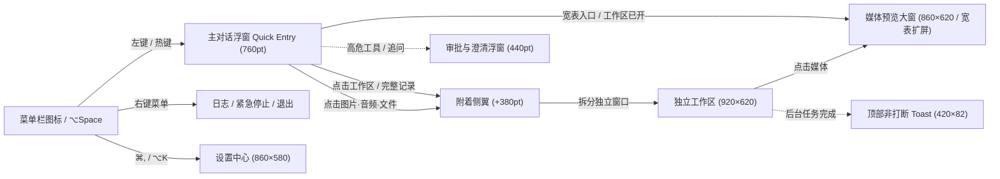

---

## Prompt 0：全局视觉语言与原生架构规范（Quiet Native Design System）

```markdown
你正在设计并实现一款原生 macOS AI 桌面伴侣应用「启明星（Qimingxing）」。请严格遵循以下「Quiet Native」设计系统与系统级架构约束：

1. **中性克制的色彩令牌（Light / Dark 自适应）**
   - 界面主体保持极简中性色，仅用高对比反转色突出主操作，彩色仅用于语义状态与内容本身：
     - `window`（窗口底色）：Dark `#0A0C10` / Light `0.96` 灰度
     - `surface`（面板主面）：Dark `#11141A` / Light `#FFFFFF`
     - `surfaceRaised`（抬升悬浮面/Hover 态）：Dark `#1A1E26` / Light `0.95` 灰度
     - `surfaceMuted`（次级胶囊/底槽）：Dark `#232833` / Light `0.91` 灰度
     - `field`（输入框底面）：Dark `#13161C` / Light `#FFFFFF`
     - `hairline`（细分割线/描边）：`Color.primary.opacity(0.10)`，线宽固定 `0.5pt`
   - **主操作反转色**：主按钮填充使用 `Color.primary`（暗色下为纯白、亮色下为纯黑），文字使用 `windowBackgroundColor`，避免暗亮模式解析错位。
   - **语义状态色**：`accent` 跟随系统强调色（软背景为 `accent.opacity(0.12)`）；`success = #34D399`；`warning = #FBBF24`；`danger = #F87171`。

2. **圆角与层级规范**
   - 主对话浮窗 `24pt`、设置窗口 `22pt`、审批弹窗 `20pt`、菜单栏 Popover `16pt`、内容卡片 `14pt`、控件/输入框 `9pt`、快捷键徽章 `5pt`，统一使用 `.continuous` 连续曲率圆角。

3. **原生材质与轻量动效**
   - 浮窗与侧栏底层使用 `NSVisualEffectView`（`.popover` / `.sidebar` / `.underWindowBackground`），`behindWindow` 混合模式，保持 `active` 状态；无头截图模式（`--dump-ui`）退化为纯色背景以便稳定出图。
   - **品牌标识（MorningStarMark）**：扁平四角星几何路径（内径为外径的 `0.26`），无底框、无发光、无渐变。
   - **环境流光边框（AmbientRimLight）**：仅在 AI 思考或流式生成期间显现（`isActive` 控制透明度 `0.25s` 淡入淡出），`1.8pt` 描边遮罩下的 `AngularGradient` 以 `2.8s` 周期线性无限旋转；空闲期彻底隐藏；系统开启「减少动态效果（Reduce Motion）」时停止旋转并降级为静态高光。
   - **地球点阵加载器（GlobeSpinner）**：24fps `TimelineView` 绘制三维经纬点阵自转动画（周期 `2.6s`，倾角 `0.42 rad`），近大远小及透明度景深变化；开启「减少动态效果」时自动暂停在固定角度。

4. **macOS 系统级行为约束**
   - 应用以 `.accessory`（菜单栏附属应用）策略运行，不在 Dock 栏和 `⌘Tab` 切换器中占坑。
   - 虽然没有可见菜单栏，但必须注入隐式 `NSMenu`（包含「关于 / 隐藏 / 退出」及「撤销 / 重做 / 剪切 / 复制 / 粘贴 / 全选」编辑菜单），确保浮窗输入框内 `⌘C/V/X/A/Z` 原生可用。
   - **单实例互斥**：启动时检查同 `bundleIdentifier` 进程；若已运行，通过 `DistributedNotificationCenter` 发送唤起通知令已有实例弹出主浮窗并退出新进程。
   - **安全与隐私兜底**：任何可点击外部链接必须校验 `http` / `https` scheme，禁止直接打开未知协议。
```

---

## Prompt 1：菜单栏常驻入口与全局快捷键

```markdown
实现启明星的菜单栏常驻控制器（MenuBarController）与全局 Carbon 热键管理器（HotkeyManager）：

1. **状态栏图标与双模交互**
   - 菜单栏显示 `16×16pt` 模板渲染（`isTemplate = true`）的四角启明星图标，自动适配浅色/深色系统菜单栏。
   - **左键点击**：切换 `280pt` 宽的 `transient` NSPopover，并在每次打开时异步刷新一次后台任务列表，动态调整 Popover 高度：`354pt + (活跃任务数 > 0 ? 22 + min(2, 活跃任务数) * 44 : 0)`。
   - **右键点击**：弹出原生 `NSMenu` 上下文菜单，依次包含：「打开对话」「打开工作区」「设置与 API Key」「打开日志目录」「紧急停止」「退出启明星」。

2. **Popover 内部结构与交互**
   - **顶部快捷动作区**：3 个带 `32pt` 高度与悬停高亮（`surfaceRaised`）的行按钮：
     - 「呼出对话」+ 右侧键帽徽章 `⌥Space`（点击后先关闭 Popover 再切换主浮窗）。
     - 「设置与 API Key」+ 右侧键帽徽章 `⌘,`。
     - 「打开工作区」（自动按主浮窗是否可见决定展开侧翼或独立窗口）。
   - **后台任务区（条件展示）**：仅当存在进行中的任务时显现，最多显示前 `2` 条。每条展示：任务标题（单行截断）、等宽百分比、右上角 `×` 取消按钮、`2pt` 高度圆角进度条、当前步骤摘要。
   - **实时感知与音频控制区**：
     - 「隐私模式」下拉菜单：支持三档实时切换——「关闭（off）」「仅窗口（meta_only）」「按需看屏（full_on_demand）」。
     - 3 个迷你开关（`.switch` / `.mini`）：「状态提示音」「朗读回答」「背景氛围音」。关闭「朗读回答」时必须立即中断正在播放的 TTS 音频并持久化到本地偏好。
   - **底部退出**：分割线下方提供「退出启明星（⌘Q）」。

3. **全局快捷键（Carbon RegisterEventHotKey）**
   - 默认绑定：`⌥Space`（显隐主对话浮窗）、`⌥K`（打开设置窗口）、`⌥Esc`（紧急停止当前生成与播报回合）。
   - 连接 Brain 后支持根据服务端 `shortcuts_sync` 下发的键位配置动态重新注册；解析失败时回退默认值。
```

### 对应界面截图

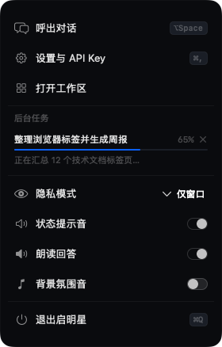

---

## Prompt 2：主对话浮窗与动态高度引擎（Quick Entry — Grand Spotlight）

```markdown
实现启明星核心交互界面「Quick Entry」悬浮主对话面板（QuickEntryPanel）：

1. **窗口物理特性与焦点接管规则**
   - 使用无边框非激活面板 `NSPanel`（`.nonactivatingPanel` + `.borderless`），置顶层级 `.floating`，支持全空间与全屏应用上方覆盖（`.canJoinAllSpaces`, `.fullScreenAuxiliary`），支持拖拽窗口空白背景移动。
   - 重写 `canBecomeKey = true`、`canBecomeMain = false`：呼出时记录此前的前台应用（`previousApp`），显式 `makeKeyAndOrderFront` 并激活自身将光标注入输入框；按 `Esc` 或关闭时 `orderOut` 并把焦点精确归还给 `previousApp`。
   - **焦点防丢失恢复**：监听 `NSWindow.willCloseNotification`（延迟 120ms）与 `NSApplication.didBecomeActiveNotification`，当设置/工作区等辅助窗关闭且主浮窗仍可见时，自动重新抢回 `keyWindow` 与输入框第一响应者身份。

2. **三态空间几何与 30Hz 弹簧高度引擎**
   - 主对话栏固定宽度 `760pt`（回答内容净宽 `696pt`，输入栏基础高 `68pt`，底栏高 `48pt`）：
     - **空闲态（Idle）**：仅展示顶部输入栏 + `4pt` 呼吸间距 + 底部工具栏，总高 `120pt`。
     - **思考态（Thinking）**：已提交问题但尚未收到首字，输入栏下方展示用户问题（最多 8 行）+ `20pt` `GlobeSpinner` + 「正在思考与调度…」或当前工具执行状态文案，基础总高 `248pt`。
     - **回答态（Answering）**：实时渲染流式正文、引用来源、内联表格入口与媒体条；高度按实际内容自适应，但受用户配置的「最大显示行数（`answerMaxLines`）」与「当前屏幕可用高度」双重上限约束，超出后内部切换为可滚动区域（短回答不显示滚动条）。
   - **平滑跟随与峰值锁定**：使用 `30Hz`（`33ms` 周期）临界阻尼弹簧（`omega = 20.0`）驱动窗口高度，从顶边向下延伸（保持 `frame.maxY` 不动），避免 `NSHostingView` 自适应反馈导致窗口抖动；在 `isGenerating` 或打字机揭示未完成期间，高度只增不减（锁定 `turnPeakHeight`），结束后平稳回归自然高度；开启「减少动态效果」时取消弹簧直接瞬切。

3. **中文 IME 安全输入框（QMXTextView）**
   - 自绘 `3pt` 宽圆角光标（`0.5s` 闪烁周期），通过 `NSLayoutManager` 计算真实字形基线坐标，解决 AppKit 多行输入框首行偏移问题；`20pt` 垂直光学内边距使单行占位符「问启明星，或搜索工作区…」与光标居中对齐。
   - **组合态保护**：`keyDown` 中检测 `hasMarkedText()`，中文拼音/五笔选词期间按下 `Enter` 或 `Esc` 绝不误触发送或关闭；非组合态下：`Enter` 提交、`Shift+Enter` 换行、`Esc` 收起。
   - **多行自适应与富媒体输入**：文本增高最多允许扩展 `8` 行（每行 `+24pt`）；支持直接 `⌘V` 粘贴剪贴板图片（自动转 PNG 上传为暂存附件，展示带进度指示的胶囊条）；支持拖拽文件（PDF/表格/文档）进入面板并显示蓝色 `1.5pt` 描边提示浮层。
   - **发送前前置校验**：按 `Enter` 与点击发送按钮必须执行同一套拦截逻辑——未连接 Brain、未配置任何可用模型、或仍有附件处于 `uploadingNames` 上传中时，禁止发包并直接在顶部错误横幅提示具体原因。

4. **流式渲染管线、性能隔离与状态容错**
   - **节流与缓存**：服务端每 `40ms` 合并一次文本 delta（在卡片、情绪、工具状态、审批、追问、UI 命令前强制立即 flush 保序，结束时通过 `Event` 立即唤醒排空）；客户端 `TypewriterText` 将解析移出 `init`，流式期按 `80ms` 节流分块（代码块 / Markdown 表格 / 段落），`InlineMarkdownText` 使用 `NSCache`（上限 48 项）缓存 `AttributedString`，且在流式自动滚底期间临时关闭 `.textSelection(.enabled)`。
   - **60Hz 揭示与 30Hz 滚底**：`TypewriterText` 以 `60Hz` 步进揭示字符，同时 `AnswerScrollView` 将自动滚底合并至 `30Hz`；通过独立状态 `parsedText == pendingParseText` 确保最后一块解析完成后才触发 `onFinish()` 恢复文本选中与解除高度锁定；开启「减少动态效果」或到达最后一帧时强制补滚一次到底部。
   - **全链路不卡死保障**：
     - 服务端 `output.turn_end` 在文本完成时立即发出，**不等待耗时的 TTS 音频合成结束**，从而立即解锁壳侧下一轮提问；服务端记录 `_turn_end_sent`，若后续新回合打断仍在播报的旧 TTS，不再对旧回合补发 `cancelled` 态 `turn_end`。
     - 壳侧校验 `turnId == currentTurnId` 才解除 `isGenerating`、清除 `toolStatusText` 与 `10s` ack 看门狗，且已非流式状态的消息不会因旧回合延迟消息被误标为 `[已中断]`；若发送后 `10s` 内 Brain 未回传 `turn_start`，看门狗自动解除锁定并弹出提示。
     - 内存 `messages` 上限保留最近 `400` 条，面板只缓存并提取最后一轮 `LiveTurn`。

5. **底部工具栏（48pt）**
   - 左侧：模型切换菜单（显示当前模型标签，点击切换；若无可用模型则显示强调色「配置模型」按钮直达设置路由页）、情绪状态胶囊 `EmotionBadge`、以及回答完成后的快捷操作组——「复制回答」（自动剥离内联 Markdown 表格，按钮变绿打勾 `1.4s`）、「有帮助 / 没帮助」反馈按钮。
   - 右侧：语音输入按钮（占位）、朗读回答开关（激活态高亮）、添加文件（点击打开 `NSOpenPanel` 前临时隐藏非激活浮窗，选完后恢复窗口与光标焦点）、看屏开关（高亮表示本轮附带屏幕画面）、新对话（清空历史并收起至 `120pt` 空闲态）、主动作按钮（生成中为红色圆形停止按钮，否则为圆形发送按钮）。
```

### 对应界面截图

**空闲态与回答态：**

| 空闲态（120pt） | 思考等待态（248pt） |
| --- | --- |
| 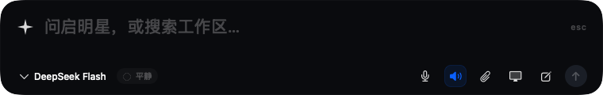 | 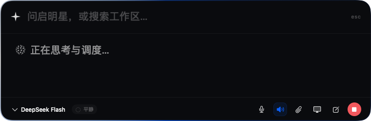 |

**流式回答展开态（含代码块、表格入口卡、引用来源与媒体条）：**

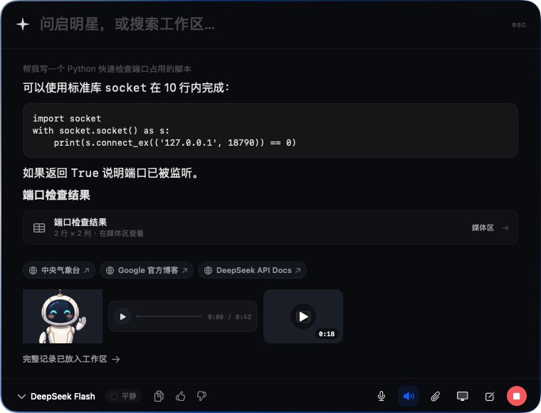

**真机 `NSPanel` 生命周期实测快照（空闲 → 问答完成 → 点击新对话收起）：**

| 1. 初始空闲（760×120） | 2. 流式展开中（760×328） | 3. 问答完成（760×746） | 4. 新对话收起（760×120） |
| --- | --- | --- | --- |
| 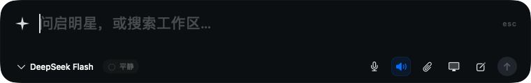 | 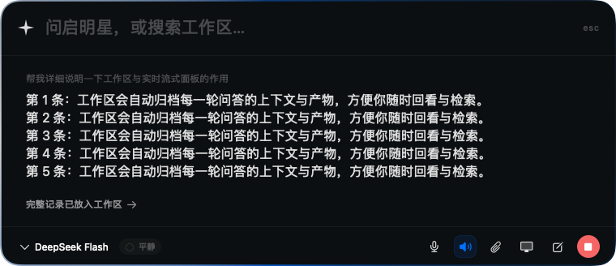 | 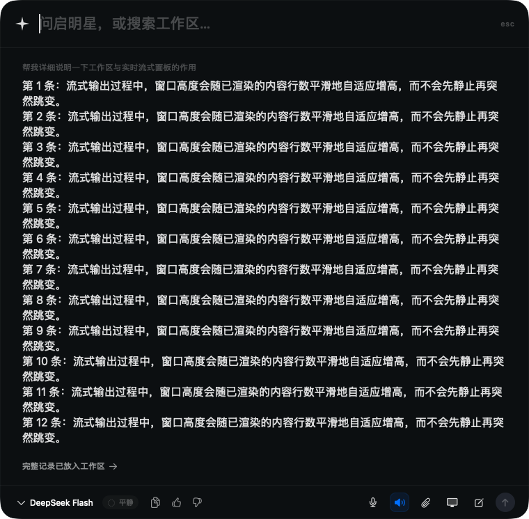 |  |

---

## Prompt 3：引用来源、内联表格入口与媒体条

```markdown
实现主对话回答区下方的信息附属组件，确保表格、来源与多媒体产物既克制又具备完整桌面能力：

1. **引用来源胶囊条（SourceChipsView）**
   - 高度 `26pt` 的横向无滚动条列表，间距 `6pt`。
   - 每个胶囊高 `24pt`，展示地球图标 + 截断至 `18` 字的标题 + 右上角外链箭头；悬停 Tooltip 显示完整标题与域名；点击仅允许通过 `http` / `https` 在默认浏览器打开。

2. **内联表格入口卡（QMXTableNotice）**
   - 正文解析器识别 Markdown 表格后，不在窄聊天流中硬撑宽表，而是就地渲染为单行卡片：表格图标 + 表格标题 + 行列规模摘要（如 `2 行 × 2 列 · 在媒体区查看`）+ 右侧「媒体区 →」。
   - 与底部媒体条联动去重：`qmxMediaWithoutInlineTables` 仅在媒体非空且正文中已渲染内联表格入口时，自动从媒体条中过滤掉同源 `md-table` 项，避免同一张表格重复出现两次（仅通过卡片事件推送的表格仍保留在媒体条中）。

3. **多媒体横条（MediaStripView）**
   - **紧凑模式（主浮窗内）**：高度 `84pt` 横向条，最多直接展示 `4` 项，超出时在末尾渲染 `44×76pt` 的 `+{N}` 溢出卡片，点击在媒体预览中查看全部。
     - **图片/视频缩略图**：`112×76pt` 圆角 `10pt` 卡片；视频叠加居中半透明圆形播放图标与右下角时长胶囊。**单击**打开媒体预览器（带轻微触觉反馈），**双击**调用系统 Quick Look，**右键菜单**提供「在媒体预览中查看」「快速预览」「复制文件」「在访达中显示」「打开来源页面」。
     - **音频胶囊**：内置独立 `MediaAudioPlayer` 原生播放控制，组件销毁或回合切换时自动停止播放。
     - **文件交付卡**：`230×56pt` 圆角卡片，展示系统原生文件图标、文件名、摘要/体积角标与打开箭头。
```

> 效果见上方 [Quick Entry 回答态](./assets/interaction-spec/quick_entry_chat.png) 中的「端口检查结果」表格入口卡、来源胶囊与图片/音频/视频媒体条。

---

## Prompt 4：附着侧翼与独立工作区（Attached Wing & Detached Workspace）

```markdown
实现启明星的「渐进式双态工作区」系统，兼顾即用即走的轻便感与长周期的归档管理：

1. **附着侧翼（WorkspaceWingView）**
   - 当主浮窗可见时触发工作区，优先从主浮窗右侧平滑展开 `380pt` 宽度侧翼（总宽变为 `1140pt`，最低高度 `430pt`），使用 `0.24s easeOut` 动画（`reduceMotion` 时瞬切）。
   - **屏幕边界自适应**：展开时若右侧超出当前屏幕 `visibleFrame`，自动记录原 X 坐标（`preWingOriginX`）并将整个面板左移至屏幕安全区内；收起侧翼时精确恢复至 `preWingOriginX`。
   - **三页签结构**：顶栏显示「工作区 · 今天 N 轮」及「拆分到独立窗口」「收起」图标按钮；页签包含：
     - 「对话」：倒序展示今日最近 `3` 轮摘要（超过 3 轮底部提示拆分查看完整记录），自动将正文表格折叠为文本摘要并隐藏代码块围栏。
     - 「任务」：最多展示 `6` 条后台任务（运行/规划/自检中显示 `GlobeSpinner`，其余显示语义色圆点 + 进度条 + 产物缩略图）。
     - 「产物」：最多展示 `8` 个文件产物，点击直接触发系统 Quick Look。
   - 底部状态栏统计「N 轮 · N 个任务 · N 个产物」并提供「独立窗口 ↗」快捷按钮。

2. **独立工作区窗口（WorkspaceWindowController）**
   - 窗口默认 `920×620pt`（最小 `820×540pt`），透明标题栏可拖动，关闭后保留实例复用。
   - **智能停靠算法（positionWindow）**：从侧翼点击「拆分」时，先等待 `280ms` 让侧翼收起，再以主浮窗为锚点按「右 → 左 → 下 → 上」顺序寻找能完整容纳 `920×620` 的空位；若当前屏幕居中后两侧均放不下但总宽度足够并排，自动将主浮窗向左平推并将工作区停靠在右侧。
   - **三栏布局**：左栏 `190pt` 筛选侧栏（今天 / 全部 / 对话 / 任务 / 产物 + 计数徽章）+ 中栏 `300pt` 搜索框与按天分组时间线 + 右栏完整详情区（完整 Markdown 正文、来源芯片、展开态媒体网格、后台任务详情/追问/停滞原因/打包目录）。

3. **增量同步与持久化**
   - `WorkspaceStore` 为每个 `ChatEntry` 维护签名（文本长度、流式状态、来源、媒体），每次 `messages` 更新仅重算签名变化的 `dirtyTurnIds`，即使 Turn 1 在 Turn 2 开始后才结束也能精准更新，且不依赖同一回合消息必须连续。
   - 最多保留 `500` 条记录，变更后防抖 `500ms` 并派发到串行后台 `DispatchQueue` 编码写入 `workspace.json`（原子写入 + `0600` 权限）；应用退出（`applicationWillTerminate`）时调用 `flushOnTerminate()` 同步等待队列落盘，确保零丢失。
```

### 对应界面截图

| 附着工作区侧翼（1140×430） | 独立工作区（基础） | 独立工作区（富媒体详情） |
| --- | --- | --- |
| 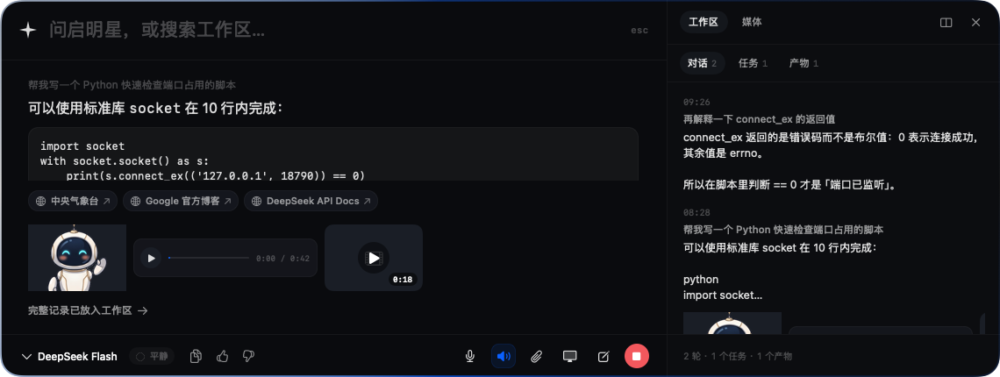 | 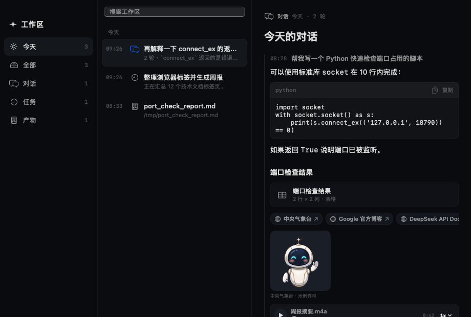 | 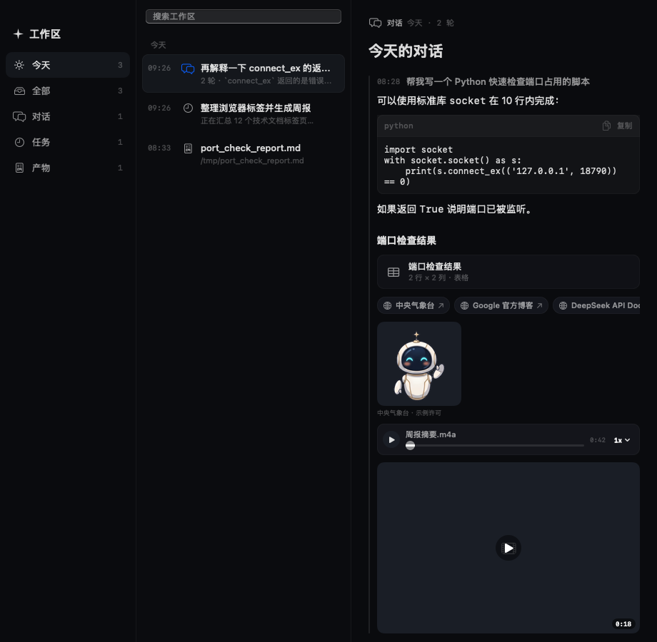 |

---

## Prompt 5：媒体预览器与宽表大窗（Media Viewer）

```markdown
实现启明星的自适应媒体与表格预览系统（MediaViewer）：

1. **双形态智能路由（MediaViewerLauncher）**
   - 若请求为宽表（`isMarkdownTable` / `prefersLargeWindow`）或独立工作区正在显示，直接打开**独立媒体大窗**（若此时主浮窗处于显示状态，则临时 `hideForMediaViewer()` 隐藏主浮窗防止遮挡宽表，并在大窗关闭 `250ms` 后自动恢复主浮窗并重新聚焦输入框）。
   - 若主浮窗可见且为普通图片/音频/视频/文件，则直接在**右侧附着侧翼**（`auxiliaryTab = .media`）中展示，保持轻量上下文。

2. **窗口规格、舞台能力与快捷键**
   - **独立窗口**：默认 `860×620pt`（最小 `640×480pt`），记忆窗口位置；当展示 Markdown 宽表时自动扩窗至 `min(1180, max(960, visible.width - 120))` × `min(820, max(680, visible.height - 140))` 并居中。
   - **多模态舞台**：支持图片自适应缩放、视频原生播放、音频播放器（侧翼收起或窗口关闭时发出 `qmxStopMediaPlayback` 立即静音停播）、文件预览以及原生交互式表格网格 `NativeTableGrid`（支持一键复制 TSV 粘贴到 Excel/Numbers）。
   - **胶片条与键盘导航**：底部固定 `82pt` 横向缩略图胶片条；独立窗口支持键盘 `←`/`→` 切换上一项/下一项、`Space` 控制音视频播停、`Esc` 关闭窗口。
   - **附着态非侵入更新提示**：当用户正在侧翼查看旧媒体而新一轮回答产生了新媒体时，不强制跳切打断，而是在顶部弹出 `28pt` 的 `pendingBanner`（「新回答包含 N 项媒体 · 切换 / ×」），由用户自主切换。
   - **独立窗与侧翼互转**：独立窗顶栏显示「已锁定」标签、「快速预览」与「停靠」按钮，点击「停靠」关闭独立窗并切回主浮窗右侧翼。
```

### 对应界面截图

| 附着媒体侧翼（表格/多媒） | 独立媒体宽表大窗 |
| --- | --- |
| 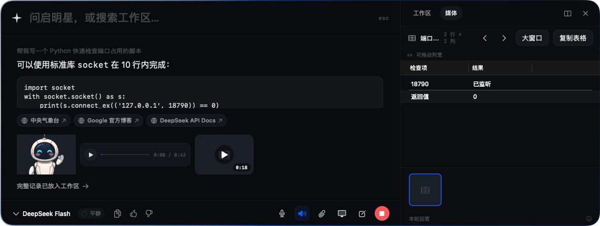 | 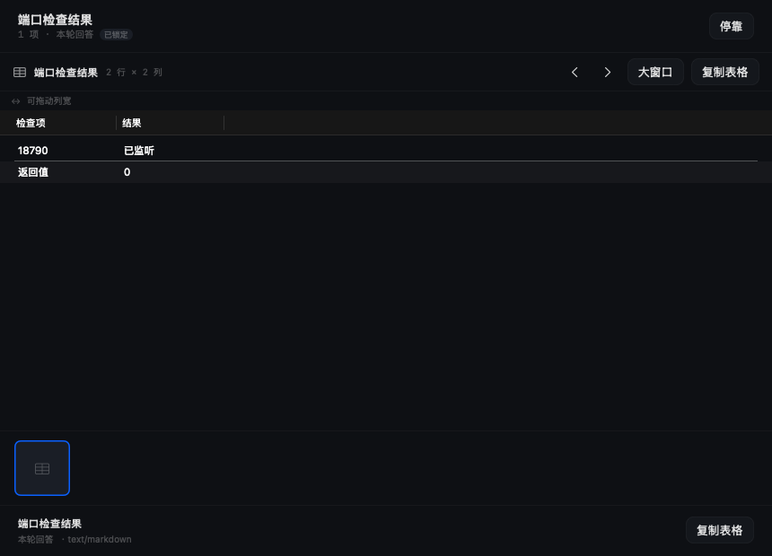 |

---

## Prompt 6：操作审批与追问澄清弹窗（Approval & Clarification Sheet）

```markdown
实现启明星的高危工具授权与信息追问浮窗（ApprovalSheetController）：

1. **窗口管理与视觉结构**
   - 固定宽度 `440pt`、圆角 `20pt` 的无边框置顶浮窗（审批态高 `360pt`，澄清态高 `300pt`），居中弹出并主动激活应用聚焦；支持跨空间与拖拽移动；按 `approvalId` 独立维护多窗口队列，后端状态同步解决后自动关闭对应窗口。

2. **两种交互模式**
   - **操作审批模式（`!isClarification`）**：
     - 头部：`shield.lefthalf.filled` 警告色图标 + 语义化自然语言标题（如「允许写入 Apple 备忘录？」「允许执行网页高危操作？」）+ 来源副标题（来自 macOS 应用联动 / 来自 MCP 工具 / 来自启明星）。
     - 详情卡片：最高 `140pt` 可滚动容器，若包含 `preview_image_path` 则置顶展示 `120pt` 高页面截图缩略图；其余参数键值经过语义化映射（如 `browser_mode` 映射为「复用主浏览器（live）」/「隔离浏览器（isolated）」），等宽字体展示且支持 `.textSelection(.enabled)`。
     - 底部控制：可选「记住本次选择」复选框（同会话免重复确认）；双胶囊按钮「拒绝」（绑定 `Esc` 快捷键）与高对比主按钮「允许」（绑定 `Enter` 默认快捷键，带触觉反馈）。
   - **追问澄清模式（`isClarification`）**：
     - 头部：`questionmark.circle.fill` 强调色图标 +「需要你的确认」。
     - 内容：若附带预设选项则渲染可整行点击的选项卡片列表（点击直接作为答复提交）；下方配 `TextField("输入答复")` + 「发送」（空输入禁用）与「取消」按钮。
```

### 对应界面截图

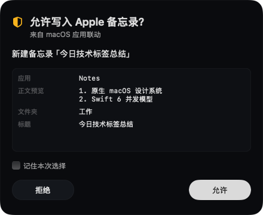

---

## Prompt 7：设置中心（Settings Window）

```markdown
实现启明星的独立设置中心窗口（SettingsWindowController）：

1. **窗口骨架与导航**
   - `860×580pt`（最小 `760×520pt`）透明标题栏窗口，关闭按钮仅执行 `orderOut(nil)` 隐藏以便瞬时重开；支持从任意地方携带 `tab` 参数直达对应分页（如无模型时点击「配置模型」直达 `routing`）。
   - 左侧 `210pt` `.sidebar` 材质导航栏分两组共 6 个分页：
     - **核心设置**：「通用与外观」「模型与路由」「语音与隐私」
     - **效率与扩展**：「快捷键」「浏览器自动化」「MCP 服务」
   - 右侧采用 `.grouped` 原生表单风格 + 底部统一保存与状态提示栏。

2. **关键分页交互细节**
   - **通用与外观**：开机自启（macOS `SMAppService.mainApp`）、虚拟形象/提示音/漫游/氛围音开关、回答字号与最大行数、以及系统权限自检与跳转。
   - **模型与路由**：
     - 服务商卡片列表（DeepSeek、Google Gemini、OpenAI 及自定义中转站），支持 API Key 脱敏回显、连通性探测、模型列表拉取，以及通过 `CustomProviderSheet` 弹出表单新增/编辑/二次确认删除自定义兼容服务商。
     - 能力槽位路由（主对话 `chat`、视觉与 OCR `vision`、快速 `fast`、后台任务 `worker`（支持跟随主对话）、语音识别 `asr`、语音合成 `tts` 与音色选择），下拉选项按槽位能力自动过滤不兼容模型（如对话槽排除 `ocr/asr/tts/embedding`）。
     - 厂商专属扩展参数：DeepSeek 思考模式/推理力度/原生联网与安全校验；Gemini 思考深度/Google Search/URL Context；Tavily 联网搜图开关与密钥配置。
   - **语音与隐私**：三档隐私策略说明与切换、语音总开关、麦克风与辅助功能权限检查。
   - **快捷键 / 浏览器自动化 / MCP 服务**：全局快捷键录制与重置、隔离浏览器与接管模式（live CDP）配置、第三方 MCP Server 列表/启停/OAuth 授权与热重载状态展示。
```

### 对应界面截图

| 通用与外观 | 语音与隐私 | 模型与路由（主视图） |
| --- | --- | --- |
| 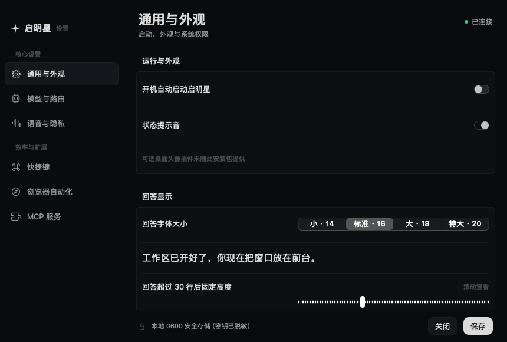 | 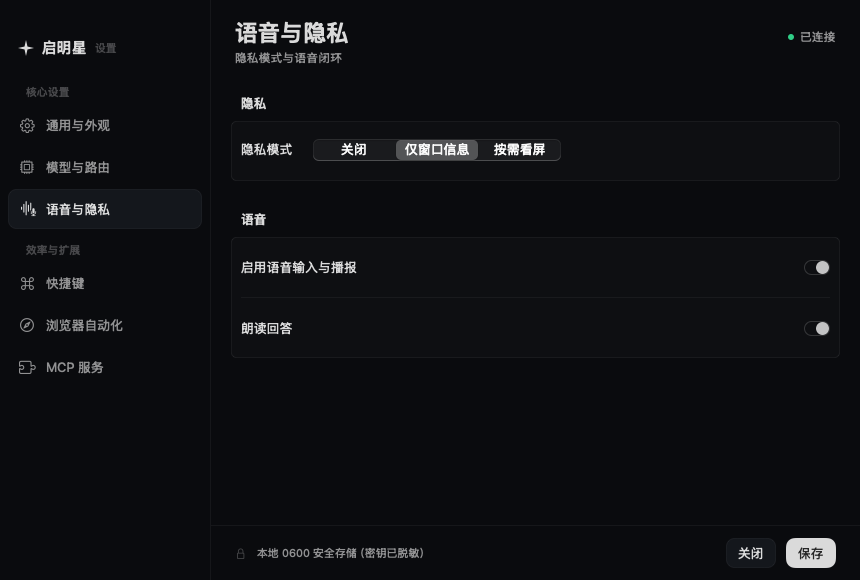 | 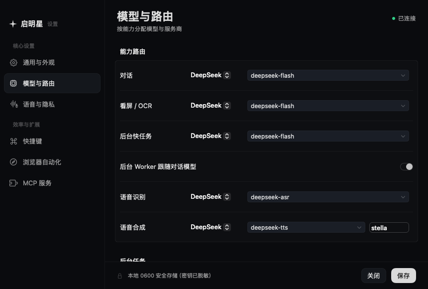 |

| 模型与路由（完整滚动内容） | 模型与路由（760pt 窄窗适配） | 新增自定义中转站弹窗 |
| --- | --- | --- |
| 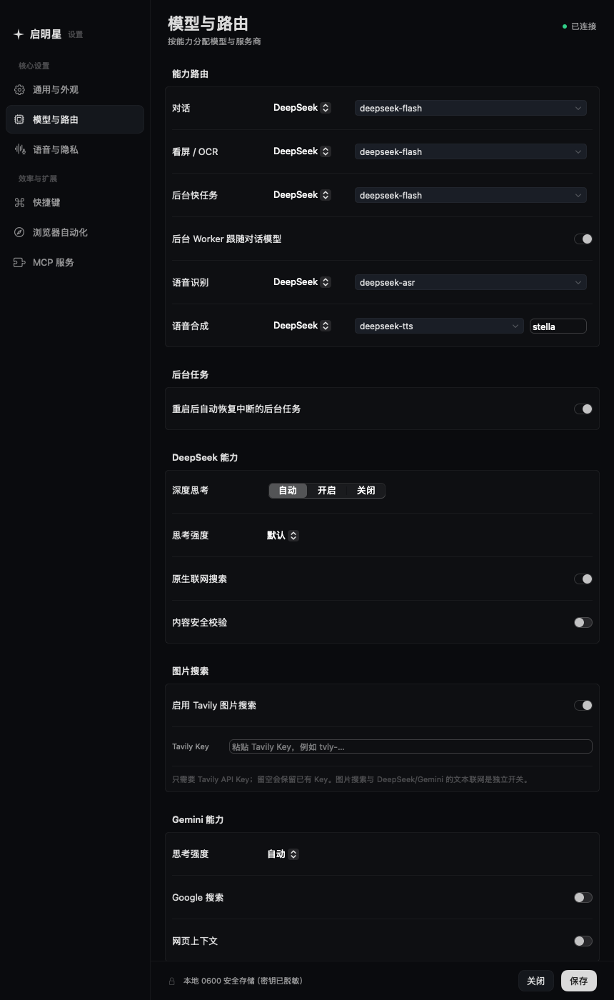 | 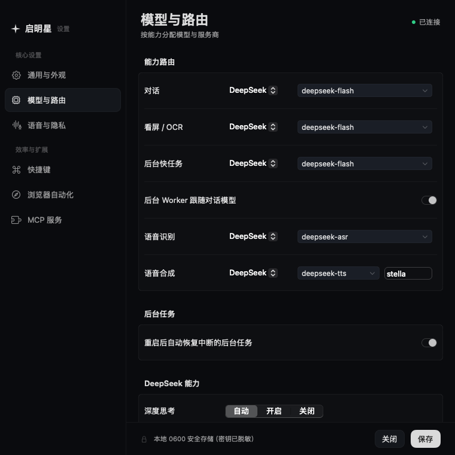 | 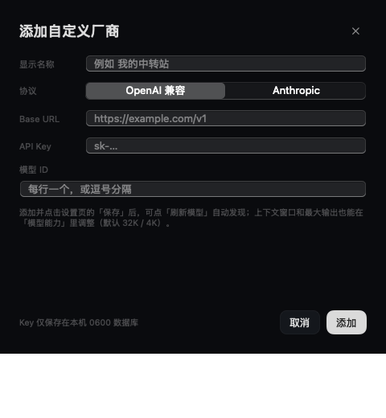 |

---

## Prompt 8：后台任务完成非打断 Toast（Task Toast）

```markdown
实现启明星的后台长任务完成顶部横幅（TaskToastController），作为系统通知中心在勿扰模式或未授权时的应用内必达补充：

1. **窗口位置与物理规则**
   - 尺寸固定 `420×82pt`，圆角 `15pt`（`NSVisualEffectView(.popover)` + `0.5pt` 分割线描边），`.nonactivatingPanel` + `.borderless`，置于 `.statusBar` 层级且不可拖动，`.ignoresCycle` 不参与窗口循环。
   - 定位在主屏幕可用区域顶部水平居中、距顶部边缘 `18pt`；以 `0.18s` 动画从透明度 `0` 淡入到 `1`，`7s` 后自动关闭并清理旧实例（新 Toast 弹出时先关闭前一个）。

2. **信息内容与防泄漏约束**
   - 左侧 `20×20pt` 语义图标（成功为绿色 `checkmark.circle.fill`，失败为橙色 `exclamationmark.triangle.fill`）。
   - 中间两行排版：单行加粗标题（`任务完成 · {title}` 或 `任务失败 · {title}`）+ 最多两行次级摘要。
   - **文案清洗规则**：`friendlyTaskMessage` 必须剥离 Markdown 标记（`**`、`` ` ``），且**绝不回落显示原始 `error_message`（避免向用户暴露 HTTP 状态码或异常堆栈）**，失败无摘要时统一展示「任务没有完成，详情可在工作区查看。」
   - 操作按钮：右上角文本按钮「关闭」，右下角小号圆角按钮「查看结果」（点击触发 `qmxOpenWorkspace` 直接进入工作区）。
```
